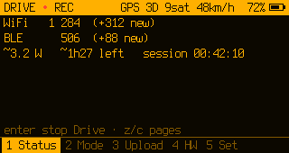

# Pfadfinder - the ultimate wardriver for the CardputerZero

> [!WARNING]
> Pfadfinder is educational software, made to learn about the radios around you. Logging and uploading Wi-Fi, Bluetooth, aircraft and mesh data may be restricted where you live, so please check your local laws before you use it. You use it at your own risk, and I am not responsible for any misuse.



Pfadfinder is a wardriver for the [M5Stack CardputerZero](https://docs.m5stack.com/en/CardputerZero). It logs Wi-Fi and Bluetooth networks with their GPS position while you drive or walk, aircraft with an RTL-SDR and the mesh nodes a Meshtastic or MeshCore device hears, and uploads them to [WiGLE](https://wigle.net), [WDGWars](https://wdgwars.pl) and [Wardrift](https://wardrift.net).

"Pfadfinder" is German for scout. It also happens to be the German name of NASA's Mars Pathfinder.

## Status

Pfadfinder logs Wi-Fi, Bluetooth, GPS, aircraft and mesh nodes, uploads to WiGLE, WDGWars and Wardrift, and shows your numbers on each site. It runs on a CardputerZero, but it is still young, so expect rough edges. These are planned next:

- LoRa mesh nodes from the Cap LoRa-1262, and a Meshtastic or MeshCore device over Bluetooth
- a "Full" mode that combines everything when the device runs on external power

CC1101 sub-GHz is not planned for now, but a new radio is a single source class (see [Adding a source](#adding-a-source)).

## What it does

- **Wi-Fi:** managed-mode scans with `iw`. A USB Wi-Fi dongle is used when one is plugged in, the internal radio otherwise. If the dongle is unplugged during a drive, it falls back to the internal radio. No monitor mode, no handshakes, nothing is sent.
- **Bluetooth:** BLE and classic discovery through BlueZ. A USB adapter is preferred, same as for Wi-Fi.
- **GPS:** everything goes through `gpsd`, so a USB receiver, a GPS on the Grove port and the GNSS on the Cap LoRa-1262 all work. The Grove port and the cap share the same UART, so only one of those two at a time. If there is more than one fix, the best one wins. Without a fix, nothing is scanned and nothing is logged.
- **Aircraft:** Sky mode starts an ADS-B decoder (`dump1090`) for a plugged-in RTL-SDR and logs every aircraft with a position. Aircraft report their own position, so Sky works without a GPS fix; with one, the decoder gets a better range.
- **Mesh nodes:** a Meshtastic or MeshCore device on USB-A or the left USB-C joins Drive and Sky when it is plugged in before the start, or runs alone in Mesh mode. Pfadfinder asks it which firmware it runs (a short Meshtastic request first, otherwise MeshCore, then Meshtastic) and logs every node it hears, with the node's own position when it has one. Nothing is sent over LoRa: no adverts, no position, no config changes. Boards with ESP32-S3 or nRF52 native USB, CP210x, CH9102 or CH340 are recognised. A board with such a chip that runs neither firmware is asked for about four minutes, then left alone until it is plugged in again. CP210x boards are taken away from `gpsd`, so a USB GPS with that chip needs its port in `DEVICES=` in `/etc/default/gpsd`.
- **Storage:** one directory per session with a WiGLE CSV 1.6 file (gzip). The file is written as separate gzip members every 30 seconds, so a dying battery loses at most the last 30 seconds. A small SQLite database keeps the unique networks, the counters and the upload history.
- **Upload:** only when no wardrive is running. WiGLE gets each finished session once. Wardrift gets the same, but only sessions from the last 72 hours, because older data earns nothing there. WDGWars gets the newest sighting of every network that was seen again since the last upload. Aircraft and mesh nodes go to WDGWars and Wardrift once per session; WDGWars takes MeshCore and Meshtastic nodes with a position, Wardrift takes all of them.
- **Screen:** five screens on the 320×170 display: Status (with the latest networks), Mode, Upload (your numbers per site), HW and Set.

## Modes

The CardputerZero cannot run every radio at the same time: the cap uses all pins of the expansion header, only two USB ports are free with the cap attached, and the battery has about 6.5 Wh. So Pfadfinder works with modes, fixed radio combinations that fit together. The Mode screen lists what each mode uses, with the optional parts in brackets. A mode that misses hardware is marked `n/a`, and the reason is shown when you select it.

| Mode | Radios | Phase |
|---|---|---|
| Drive | Wi-Fi, Bluetooth, GPS, a mesh node on USB if plugged in | 1, 4a (now) |
| Sky | aircraft (ADS-B) with an RTL-SDR, GPS optional, a mesh node on USB if plugged in | 3, 4a (now) |
| Mesh | a mesh node on USB, GPS optional, no Wi-Fi or Bluetooth scans | 4a (now) |
| Drive + Cap | Drive plus the Cap LoRa-1262 | 4b |
| Full | everything, on external power | 5 |

## Saving power

The logging runs as a background service, so the screen app can be closed and the screen can be off while driving.

- The screen turns off 10 seconds after the last key press. Any key wakes it up and does nothing else. In "mount" mode (Settings) it dims and keeps updating every 5 seconds instead.
- The scan interval follows your speed: every 3 seconds while driving, every 10 seconds while walking, every 60 seconds after standing still for a minute. Without a GPS fix the scanners pause.
- Bluetooth discovery runs in windows of at most 10 seconds.
- During a wardrive the CPU uses the `powersave` governor and three of the four cores are switched off. Everything is restored when you stop.

The power numbers in the app are estimates until I measure them on the device. `python3 -m pfadfinder.tools.powerlog` logs the real battery draw for that.

## Install

Pfadfinder is a Debian package for the CardputerZero launcher (APPLaunch).

```sh
scp pfadfinder_0.1.1_all.deb pi@<device>:/tmp/
ssh pi@<device> sudo apt install /tmp/pfadfinder_0.1.1_all.deb
```

The package installs the `pfadfinder-core` service (runs as `pi`, not as root), adds `pi` to the groups it needs and adds "Pfadfinder" to the launcher. Log out and back in once, so the new groups apply.

Sky mode needs an ADS-B decoder with RTL-SDR support: `dump1090` (dump1090-fa) or a `readsb` built with RTL-SDR. Debian's `readsb` package is built without it, so it does not count. Without such a decoder, Sky shows "no ADS-B decoder with RTL-SDR support". The CardputerSDR app uses the same stick; while it is open, Sky mode says the RTL-SDR is in use.

The install also sets up `gpsd` for a GPS on the Grove port, on the Cap LoRa-1262 and on USB. An existing `gpsd` setup is kept, so the CardputerZero image's settings for the cap stay as they are. Only on an image where the UART is still off, the install turns it on and asks for one reboot.

## Usage

| Key | Action |
|---|---|
| `1` to `5` | Status, Mode, Upload, HW, Set |
| `z` `c` (◀ ▶) | previous / next page (Status: overview, Wi-Fi, Bluetooth, aircraft, mesh; Upload: one page per site) |
| `f` `x` (▲ ▼) | up / down, scroll the network lists |
| `Enter` | start or stop a mode (Status: Drive, Sky on the aircraft page, Mesh on the mesh page; Mode: the selected one), edit a setting (Set) |
| `u` | upload to the site on screen, `a` to all sites |
| `Esc` | back to Status, quit on Status |

The arrows printed on `f` `x` `z` `c` also work with `fn`. Every screen shows the keys that work there in its last line but one, and the menu in the last line.

## Configuration

All settings live in `~/.config/pfadfinder/config.toml`. The file is created on the first start with every setting and a comment for each, and only `pi` can read it.

You can type the keys for all three sites on the Set screen (`5`). For long keys, SSH is easier:

```sh
ssh <user>@<device>
nano ~/.config/pfadfinder/config.toml
```

```toml
[wigle]
# from https://wigle.net/account
api_name = "AID..."
api_token = "..."

[wdgwars]
# from https://wdgwars.pl/profile (API Keys)
api_key = "..."

[wardrift]
# from the Wardrift dashboard (API keys)
api_key = "..."
# only for your numbers on the Upload screen
username = "..."
password = "..."
```

Each site only needs its own section, leave out the ones you don't use. Wardrift shows your numbers only after a sign-in: Pfadfinder signs in once with your username and password, keeps the session and clears the password line in the file.

Changes are picked up within 30 seconds, no restart needed. If the file has a syntax error, Pfadfinder keeps the last working settings and shows the error on the status screen.

You can also change everything in Settings on the device. A change there replaces only its own line in the file, so your comments and edits stay. The token is never shown on the screen.

The data lives in `~/.local/share/pfadfinder/`. Every session directory has a `wifi-bt.wiglecsv.gz` that you can also upload by hand.

If the device loses power during a drive, the next start closes the broken session and continues in a new one. A clean reboot, shutdown or update ends the drive instead. "Drive on boot" in Settings starts Drive automatically, which is handy if the device stays in a pocket.

## Adding a source

A source is a class with a name, the kinds of data it emits and the hardware it claims:

```python
@register
class MySource(Source):
    name = "mysource"
    kinds = frozenset({Kind.WIFI})
    power_w = 0.5

    @classmethod
    def detect(cls, sys):
        return [Device("mysource", "/dev/ttyUSB0", "my stick", False, (Claim("usb:/dev/ttyUSB0"),))]

    async def run(self, ctx):
        while True:
            ctx.emit(...)  # one Observation per sighting
```

Two sources that claim the same exclusive resource (a UART, the SPI bus, a USB port) are never started together. A shared claim, like a Bluetooth adapter, can be used by more than one source. Other packages can add sources through the `pfadfinder.sources` entry point group. Modes are plain data in `pfadfinder/modes.toml`.

## Development

The tests and the package build run in a Debian bookworm container, the same userland as the device:

```sh
./dev pytest -q
PFADFINDER_MAINTAINER="Your Name <you@example.com>" ./dev packaging/build-deb.sh
```

The second command writes `build/pfadfinder_<version>_all.deb`.

## Credits

The uploads to WiGLE, WDGWars and Wardrift use the site clients of [wdgwars-uploader](https://github.com/RocketGod-git/wdgwars-uploader) by RocketGod (MIT), which does the same job on Windows. They are bundled unchanged in `vendor/wdgwars_uploader/`, pinned to the commit in `vendor/REFERENCE`; `tools/update-reference.sh <commit>` refreshes them.

The package ships [dbus-fast](https://github.com/Bluetooth-Devices/dbus-fast) (MIT) to talk to BlueZ, and [meshtastic](https://github.com/meshtastic/python) (GPL-3.0), [meshcore](https://github.com/meshcore-dev/meshcore_py) (MIT) and their pure-Python dependencies for mesh nodes, pinned in `packaging/mesh-requirements.txt`. The screen uses the [Terminus](https://files.ax86.net/terminus-ttf/) font (SIL Open Font License). Their licenses are included in the package.

## License

GPL-3.0-or-later, see [LICENSE](LICENSE). The bundled third-party code keeps its own license.
